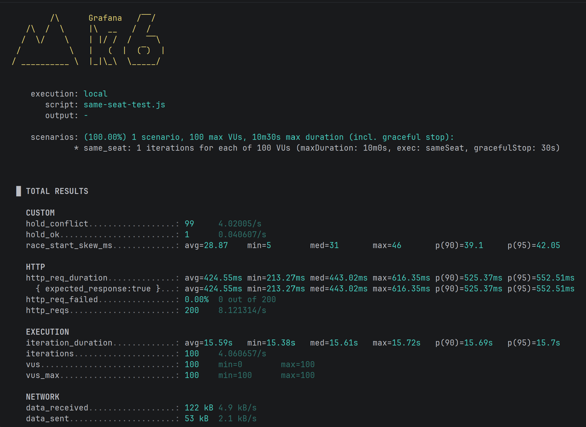

# 명당

> 공연 예매 시스템
<!-- 배포했다면 링크, 시연 GIF나 대표 스크린샷을 여기에 넣으세요 -->

<br>

## 📌 프로젝트 소개

- **개발 기간**: 2026.10.12 ~ 현재
- **개발 인원**: 1명 (개인 프로젝트)
- **만든 이유**: 부산 국제 영화제의 예매시스템을 사용하며 결제까지 진행이됐는데도 다른사람이 먼저 결제를하면 실패하는 경험을 하고 예매 시스템의 궁금함이 생겨 직접 만들게 됐습니다.

<br>

## 🛠 기술 스택

| 구분 | 기술 |
| --- | --- |
| Language | Java 21 |
| Framework | Spring Boot 4.1.1 |
| Persistence | JPA |
| Database | MySQL |
| Build Tool | Gradle |
| Frontend | React |
| Cache | Redis |
| Container | Docker, Docker Compose | 
| Deployment / Infrastructure | AWS EC2, Nginx |
| Etc. | Git, GitHub, IntelliJ |

<br>

## ✨ 주요 기능

### 회원
- 회원가입, 로그인, 로그아웃
- JWT Access Token / Refresh Token 기반 인증
- 소셜 로그인(OAuth2) 지원
- 내 정보 조회, 수정, 탈퇴
- 아이디 중복 확인

### 공연
- 공연 생성, 목록 조회, 삭제
- 공연별 좌석 자동 생성
- 공연별 좌석 상태 조회
- 공연 관리 API 제공 (관리자 권한 검증 보완 예정)

### 좌석 및 예매
- 좌석 상태 관리: `AVAILABLE`(예매 가능), `HELD`(임시 점유), `SOLD`(판매 완료)
- 좌석 홀드, 확정, 취소 처리
- 장바구니에 좌석 추가 및 조회
- 예매 티켓 생성, 조회, 취소

### 대기열
- Redis 기반 대기열 등록 및 퇴장
- 현재 대기 순번 조회
- 입장 가능 여부에 따른 `ALLOWED`, `WAITING`, `NONE` 상태 제공

<br>

## 📂 프로젝트 구조

```
ticketing/
├── README.md
├── ticketing-backend/
│   ├── build.gradle
│   ├── docker-compose.yaml       # MySQL, Redis 컨테이너
│   └── src/
│       ├── main/
│       │   ├── java/com/hello/ticketingbackend/
│       │   │   ├── TicketingBackendApplication.java
│       │   │   ├── config/       # Spring, Security, Redis, 스케줄러 설정
│       │   │   ├── controller/   # REST API 엔드포인트
│       │   │   ├── domain/       # 도메인별 비즈니스 모듈
│       │   │   │   ├── user/     # 회원 및 소셜 로그인
│       │   │   │   ├── jwt/      # JWT 및 refresh token
│       │   │   │   ├── concert/  # 공연 관리
│       │   │   │   ├── seat/     # 좌석 조회 및 점유
│       │   │   │   ├── cart/     # 장바구니 및 좌석 홀드
│       │   │   │   ├── ticket/   # 예매 티켓
│       │   │   │   └── waiting/  # 대기열 및 입장 스케줄러
│       │   │   ├── exception/    # 예외 및 에러 응답
│       │   │   ├── fillter/      # JWT, 로그인 필터
│       │   │   ├── handler/      # 로그인 성공 및 전역 예외 처리
│       │   │   ├── interceptor/  # 좌석 홀드 검증
│       │   │   └── util/         # JWT 유틸리티
│       │   └── resources/
│       │       └── application.properties
│       └── test/                 # 백엔드 테스트
└── ticketing-frontend/
    ├── package.json
    ├── vite.config.js            # Vite 및 백엔드 프록시 설정
    └── src/
        ├── main.jsx              # 애플리케이션 진입점
        ├── app/                  # 라우팅 및 앱 루트
        ├── pages/                # 화면 단위 페이지
        │   ├── AuthPage.jsx
        │   ├── ConcertPage.jsx
        │   ├── SeatPage.jsx
        │   ├── CartPage.jsx
        │   ├── PaymentPage.jsx
        │   ├── TicketsPage.jsx
        │   └── UserPage.jsx
        ├── features/             # 기능 단위 모듈
        │   ├── auth/             # 인증 API, 폼, 인증 훅
        │   ├── concert/          # 공연 목록 및 조회
        │   ├── seat/             # 좌석 맵, 좌석 상태, 예매
        │   ├── cart/             # 장바구니
        │   └── waiting/          # 대기열 모달 및 상태 조회
        ├── shared/
        │   ├── api/              # Axios 클라이언트 및 공통 API 설정
        │   └── layout/           # 공통 레이아웃
        ├── App.css               # 전역 컴포넌트 스타일
        └── index.css             # 전역 기본 스타일
```

### 구조 설계

- **Backend**는 도메인별로 `dto`, `entity`, `repository`, `service`를 분리한 모듈형 구조입니다.
- **Frontend**는 화면(`pages`)과 기능(`features`)을 분리하고, 각 기능에서 API·컴포넌트·훅을 함께 관리합니다.
- **대기열**은 Redis 기반 백엔드 로직과 프론트엔드 대기 모달이 `waiting` 도메인으로 연결됩니다.
- **인프라**는 `docker-compose.yaml`로 MySQL과 Redis를 함께 실행할 수 있습니다.

<br>

## 🗄 ERD


<br>

## 📑 API 명세

> 모든 API는 별도 표기가 없으면 `Authorization: Bearer {accessToken}` 헤더가 필요합니다.
> 요청 및 응답 본문은 JSON 형식을 사용합니다. 인증이 필요한 API는 인증되지 않은 경우 `401 Unauthorized`, 권한이 부족한 경우 `403 Forbidden`을 반환합니다.

### 인증 및 회원

| 기능 | Method | URL | 인증 | 설명 |
| --- | --- | --- | --- | --- |
| 로그인 | POST | `/login` | 불필요 | 아이디와 비밀번호로 로그인하고 JWT를 발급합니다. |
| 회원가입 | POST | `/api/user` | 불필요 | 신규 회원을 등록합니다. |
| 아이디 중복 확인 | POST | `/api/user/exist` | 불필요 | 아이디 존재 여부를 `boolean`으로 반환합니다. |
| JWT 교환 | POST | `/jwt/exchange` | 불필요 | 로그인 쿠키의 토큰을 헤더 응답 형식으로 교환합니다. |
| JWT 갱신 | POST | `/jwt/refresh` | 불필요 | Refresh Token으로 Access Token을 갱신합니다. |
| 내 정보 조회 | GET | `/api/user` | USER | 로그인한 사용자의 정보를 조회합니다. |
| 회원정보 수정 | PUT | `/api/user` | USER | 닉네임, 이메일 등 회원정보를 수정합니다. |
| 회원 탈퇴 | DELETE | `/api/user` | USER | 비밀번호 확인 후 회원을 탈퇴합니다. |

### 공연 및 좌석

| 기능 | Method | URL | 인증 | 설명 |
| --- | --- | --- | --- | --- |
| 공연 생성 | POST | `/api/concerts` | 필요 | 공연명과 좌석 수를 등록하고 공연 ID를 반환합니다. |
| 공연 목록 조회 | GET | `/api/concerts` | 필요 | 등록된 공연 목록을 조회합니다. |
| 공연 삭제 | DELETE | `/api/concerts/{concertId}` | 필요 | 공연을 삭제합니다. 관리자 권한 검증을 적용할 예정입니다. |
| 좌석 생성 | POST | `/api/seats` | 필요 | 공연에 좌석을 생성합니다. |
| 공연 좌석 조회 | GET | `/api/concerts/{concertId}/seats` | 필요 | 공연의 좌석 ID와 현재 상태를 조회합니다. |
| 좌석 홀드 | POST | `/api/seats/{seatId}/hold` | 필요 | 예매를 위해 좌석을 임시 점유합니다. |
| 좌석 확정 | POST | `/api/seats/{seatId}/confirm` | 필요 | 홀드된 좌석을 판매 완료 상태로 변경합니다. |
| 좌석 홀드 취소 | POST | `/api/seats/{seatId}/cancel` | 필요 | 홀드된 좌석을 다시 예매 가능 상태로 변경합니다. |

### 장바구니 및 예매

| 기능 | Method | URL | 인증 | 설명 |
| --- | --- | --- | --- | --- |
| 장바구니 조회 | GET | `/api/items` | 필요 | 로그인한 사용자의 장바구니를 조회합니다. |
| 장바구니 추가 | POST | `/api/items` | 필요 | 좌석을 장바구니에 추가합니다. |
| 장바구니 항목 삭제 | DELETE | `/api/items` | 필요 | 결제 완료 후 장바구니 항목을 삭제합니다. |
| 장바구니 항목 해제 | DELETE | `/api/items/release` | 필요 | 결제 전 항목을 삭제하고 좌석 홀드를 해제합니다. |
| 티켓 생성 | POST | `/api/tickets/{seatId}` | 필요 | 로그인한 사용자의 좌석 예매 티켓을 생성합니다. |
| 내 티켓 조회 | GET | `/api/tickets` | 필요 | 로그인한 사용자의 예매 내역을 조회합니다. |
| 티켓 취소 | DELETE | `/api/tickets/{ticketId}` | 필요 | 예매 티켓을 취소합니다. |

### 대기열

| 기능 | Method | URL | 인증 | 설명 |
| --- | --- | --- | --- | --- |
| 대기열 입장 | POST | `/waiting/enter` | 필요 | 입장 가능 여부를 확인하고, 불가하면 대기열에 등록합니다. |
| 대기열 상태 조회 | GET | `/waiting/status` | 필요 | `ALLOWED`, `WAITING`, `NONE` 상태와 대기 순번을 조회합니다. |
| 대기열 나가기 | DELETE | `/waiting/delete` | 필요 | 현재 사용자를 대기열에서 제거합니다. |

<details>
<summary>주요 요청/응답 예시 (펼치기)</summary>

**POST `/api/user` 회원가입**

```json
// Request
{
  "username": "ticket_user",
  "password": "password1234",
  "nickname": "티켓 사용자",
  "email": "user@example.com"
}

// Response 201
{
  "userEntityId": 1
}
```

**POST `/login` 로그인**

```json
// Request
{
  "username": "ticket_user",
  "password": "password1234"
}

// Response 200
{
  "accessToken": "eyJhbGciOiJIUzI1NiJ9...",
  "refreshToken": "eyJhbGciOiJIUzI1NiJ9..."
}
```

**GET `/api/concerts/{concertId}/seats` 좌석 조회**

```json
// Response 200
[
  {
    "id": 1,
    "status": "AVAILABLE"
  },
  {
    "id": 2,
    "status": "HELD"
  }
]
```

**GET `/waiting/status` 대기열 상태 조회**

```json
// Response 200
{
  "status": "WAITING",
  "rank": 12
}
```

</details>

<br>

## 📈 동시성 테스트

좌석 예매 과정에서 여러 사용자가 동시에 요청하는 상황을 검증하기 위해 [k6](https://k6.io/)를 사용했습니다. 테스트 스크립트는 [ticketing-backend/k6/](C:/Users/guseh/OneDrive/바탕%20화면/ticketing/ticketing-backend/k6/)에 관리하고 있습니다.

### 테스트 목적

- 동일 좌석에 대한 동시 예매 요청 처리 검증
- 좌석 중복 예매 및 상태 변경 정합성 확인
- 대기열 진입부터 좌석 조회 및 좌석 홀드까지의 부하 검증

### 테스트 스크립트

| 스크립트 | 목적 | 기본 설정 |
| --- | --- | --- |
| `same-seat-test.js` | 여러 사용자가 동일 좌석에 동시에 홀드 요청하여 좌석 중복 점유 여부 검증 | VU 100명, 좌석 ID 42 |
| `queue-load-test.js` | 다수 사용자가 대기열을 거쳐 좌석을 조회하고 선점하는 전체 흐름 검증 | VU 1,000명, 대기열 사용 |

### 테스트 과정

#### 1. 동일 좌석 경쟁 테스트

1. `SAME_VUS`명의 테스트 사용자를 준비하고 로그인하여 JWT를 발급합니다.
2. 모든 VU가 동일한 `TARGET_SEAT` 좌석을 대상으로 동시에 홀드 요청을 보냅니다.
3. 요청 결과를 성공(`2xx`), 충돌(`409`), 기타 오류로 분류합니다.
4. 테스트 종료 후 성공 요청은 1건인지, 좌석이 중복 점유되지 않았는지 확인합니다.
5. `race_start_skew_ms` 지표로 요청 시작 시점의 편차를 확인합니다.

```powershell
k6 run `
  -e BASE_URL=http://localhost:8080 `
  -e SAME_VUS=100 `
  -e TARGET_SEAT=42 `
  ticketing-backend/k6/same-seat-test.js
```

#### 2. 대기열 및 좌석 선점 부하 테스트

1. `VUS`명의 테스트 사용자를 배치로 로그인합니다. 필요한 경우 `SIGNUP=true`로 회원가입을 먼저 실행합니다.
2. 각 VU가 `/waiting/enter`를 호출하고, 입장 전이면 `/waiting/status`를 5초 간격으로 확인합니다.
3. 입장이 허용되면 `/api/concerts/{concertId}/seats`에서 예매 가능한 좌석을 조회합니다.
4. 좌석 홀드를 최대 10회 시도하고, 다른 사용자가 먼저 점유한 경우 `409 Conflict`를 기록한 뒤 다른 좌석으로 재시도합니다.
5. 대기열 시간 초과, 매진, 서버 오류 및 좌석 홀드 성공·충돌 건수를 확인합니다.

```powershell
k6 run `
  -e BASE_URL=http://localhost:8080 `
  -e VUS=1000 `
  -e CONCERT_ID=7 `
  -e USE_QUEUE=true `
  ticketing-backend/k6/queue-load-test.js
```

### 테스트 환경

| 항목 | 내용 |
| --- | --- |
| 테스트 도구 | k6 |
| 테스트 스크립트 | `same-seat-test.js`, `queue-load-test.js` |
| 테스트 일시 | YYYY-MM-DD |
| 실행 환경 | 로컬 / Docker / AWS |
| 대상 API | 대기열, 좌석 조회, `POST /api/seats/{seatId}/hold` |
| 동시 사용자 수 | 동일 좌석 100명 / 부하 테스트 1,000명 |

### 테스트 결과

#### 동일 좌석 경쟁 테스트

| 지표 | 결과 |
| --- | --- |
| 총 홀드 요청 수 | 100 |
| 홀드 성공 수 (`hold_ok`) |  |
| 충돌 응답 수 (`hold_conflict`) |  |
| 기타 오류 수 (`hold_error`) |  |
| 중복 점유 발생 여부 | 없음 / 있음 |
| 요청 시작 편차 (`race_start_skew_ms`) |  |

#### 대기열 및 좌석 선점 부하 테스트

| 지표 | 결과 |
| --- | --- |
| 최대 VU | 1,000 |
| 홀드 성공 수 (`hold_success`) |  |
| 좌석 충돌 수 (`hold_conflict`) |  |
| 기타 오류 수 (`hold_error`) |  |
| 대기열 시간 초과 수 (`queue_timeout`) |  |
| 매진 처리 수 (`sold_out`) |  |
| 대기열 평균 대기 시간 (`queue_wait_time`) |  |
| 상태 조회 `p(95)` |  |
| 좌석 홀드 `p(95)` |  |

> 위 결과 칸에는 k6 실행 결과의 실제 값을 기록합니다. `queue-load-test.js`는 상태 조회 `p(95) < 500ms`, 좌석 홀드 `p(95) < 1,000ms`, `hold_error = 0`, `queue_timeout = 0`을 통과 기준으로 설정합니다.

### 테스트 결과 이미지


.png)
.png)

<!--
이미지 파일 예시:
- docs/images/k6-same-seat-result.png
- docs/images/k6-queue-load-result.png
-->

### 결과 분석 및 개선 사항

- **문제 상황**:
- **원인**:
- **해결 방법**:
- **검증 결과**:

<br>

## 🔥 트러블슈팅

### 1. 문제 상황 제목
- **문제**: 어떤 상황에서 어떤 문제가 발생했는지
- **원인**: 왜 발생했는지 (어떻게 원인을 찾았는지)
- **해결**: 어떻게 해결했는지
- **배운 점**: 이 경험으로 알게 된 것

### 2. 문제 상황 제목
- **문제**:
- **원인**:
- **해결**:
- **배운 점**:

<br>

## 💡 기술적 고민

- **왜 이 기술/구조를 선택했는가?** (예: Entity와 DTO를 분리한 이유)
- **다른 선택지와 비교했을 때의 장단점**

<br>

## 📝 회고

- **잘한 점**:
- **아쉬운 점**:
- **앞으로 개선할 점**:
  - [ ] 테스트 코드 추가
  - [ ] 배포 (AWS 등)
  - [ ] 성능 개선 (N+1, 인덱스 등)
